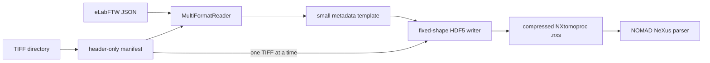

# Architecture and production workflow

## Decision

The implementation deliberately combines two mechanisms:

1. `XRMReader`, derived from pynxtools `MultiFormatReader`, dispatches the
   eLabFTW JSON and produces only metadata and three one-dimensional coordinate
   arrays.
2. `convert_tomoproc` creates `/entry/data/data` once, with its final shape,
   chunking and gzip filter. It reads exactly one TIFF, writes one Y layer, and
   releases that image before opening the next.

The supported public conversion interfaces are `pynx-xrm convert` and the
NOMAD `XRMDataConverter`. Standard `pynx convert --reader xrm` is rejected with
an explanatory error because the core writer cannot consume the streaming
dataset without first receiving a complete in-memory volume.

Passing all pixels through a normal pynxtools template would require a complete
3-D NumPy array. Reopening the standard writer in append mode would not solve
this: an existing dataset is not resized by that writer. The direct HDF5 phase
is therefore the bounded-memory production path while the reader remains the
metadata integration point.



## File responsibilities

| File | Responsibility |
|---|---|
| `reader.py` | Multi-format dispatch and NXtomoproc metadata paths; never returns the volume. |
| `metadata.py` | eLabFTW field mapping, required-field fallbacks, and audit assumptions. |
| `tiff_stack.py` | Numeric ordering, contiguity/header validation, and single-layer iterator. |
| `models.py` | Immutable manifest, compression settings, and conversion report. |
| `streaming_writer.py` | Atomic fixed-shape HDF5 creation, gzip chunks, layer writes, and structural checks. |
| `cli.py` | Local `inspect` and `convert` commands. |
| `nomad/schema_packages/` | NOMAD ELN schema and worker-side conversion normalizer. |
| `tests/test_streaming_conversion.py` | Synthetic proof of shape, orientation, coordinates, compression and reader/writer separation. |

## Data and coordinate mapping

A TIFF decoder returns `(rows, columns) = (z, x)`. Numbered TIFF files are the
Y layers. Consequently the NXtomoproc dataset is `(nX, nY, nZ)` and layer `i`
is assigned with `dataset[:, i, :] = image.T`. The coordinate formula for every
axis is

`coordinate[i] = (i - (n - 1) / 2) * voxel_size`.

It places the geometric center at zero for both odd and even axis lengths.

The required structure follows the official
[`NXtomoproc.nxdl.xml`](https://github.com/nexusformat/definitions/blob/main/applications/NXtomoproc.nxdl.xml).

| Source | NXtomoproc destination | Supplied value / rule |
|---|---|---|
| eLabFTW record `title` | `/entry/title` | `6100_SDP_XRM_576_001` |
| constant | `/entry/definition` | `NXtomoproc` |
| `XRM system / instrument` | `/entry/instrument/source/name` | `XRM system / instrument 109` |
| constants | source `type`, `probe` | `Fixed Tube X-ray`, `x-ray` |
| `Sample name` | `/entry/sample/name` | `AvCarb_FLEX_20bar` |
| `Reconstruction software` | `/entry/reconstruction/program` | `Dragonfly 3D` |
| `Software version` | `/entry/reconstruction/version` | fallback `unknown` |
| `Measurement date` | `/entry/reconstruction/date` | date converted to NX_DATE_TIME |
| `Raw data path` or discovery | `.../parameters/raw_file` | selected acquisition `.txrm` path |
| reconstructed/acquisition pixel size | `/entry/data/{x,y,z}` | centered isotropic coordinates in `um` |
| numbered TIFF pixels | `/entry/data/data` | `(x, y, z)`, dimensionless intensity |

Acquisition fields such as voltage, power, objective, exposure and projection
count are retained below `/entry/reconstruction/parameters` using normalized
lower-case names.

## Compression and memory behavior

The dataset is created with its final dimensions and `uint16` source type.
Chunks always have Y extent 1 so a chunk never spans several input files. The
default chunk target is 1 MiB and the portable filter is gzip level 4 with the
shuffle pre-filter. Only a decoded 2-D layer and HDF5's bounded chunk cache are
resident; the implementation never invokes `stack`, `concatenate`, or creates
a full-volume NumPy allocation.

The output is first written as a hidden `.part` file. It is structurally checked
and atomically moved to its requested name only after all layers were written.

## Metadata fallbacks for the supplied dataset

The eLabFTW field `Reconstructed voxel size` is empty, so the supplied
`Acquisition pixel size = 0.681 um` is used isotropically as requested. The
software version is absent and becomes `unknown`. Only a measurement date is
available; NXtomoproc requires a date-time, so midnight UTC is appended. The
empty raw-data path is resolved to the largest matching, non-scout `.txrm`
file. Every fallback is returned in `ConversionReport.assumptions` and stored
in the NOMAD converter entry.

`transform="none"`, `offset="0.0"`, and `scaling="1.0"` state explicitly that the
stored reconstructed intensity values are not transformed. Intensity units are
`1` (dimensionless).

## NOMAD Oasis operation

Install this package with the `nomad` extra into the Oasis Python environment
and enable its three `nomad.plugin` entry points. Upload the JSON, the TIFF
directory, and an archive YAML containing an `XRMDataConverter` section. Set:

- `metadata_file` to the upload-relative JSON filename;
- `tiff_directory` to the upload-relative image directory;
- `output` to an `.nxs` path;
- `export: true`.

During normalization, the worker calls the same streaming converter, registers
the generated file with `process_updated_raw_file`, and NOMAD then creates the
normal NeXus entry. Worker scratch/upload storage must accommodate the final
compressed file. The operation is idempotent: reprocessing replaces only the
configured output file through an atomic `.part` file.

For the supplied data, `AvCarb_FLEX_20bar.archive.yaml` is ready to use as the
NOMAD mainfile. The package must first be installed and enabled in the Oasis;
that deployment step requires access to the Oasis configuration and restart
procedure and cannot be performed from this repository alone.

## Implementation and deployment checklist

| Step | State | Who can do it |
|---|---|---|
| Inspect TIFF geometry, type and ordering | complete | implemented and verified here |
| Map JSON metadata and record fallbacks | complete | implemented and verified here |
| Implement `MultiFormatReader` metadata phase | complete | implemented here |
| Implement fixed-shape gzip streaming writer | complete | implemented and end-to-end verified here |
| Add local CLI and automated synthetic tests | complete | implemented here |
| Add NOMAD schema-package/normalizer | complete | implemented; schema import verified |
| Install plugin in the target Oasis | pending deployment | I can prepare/configure it when the Oasis repository or deployment access is provided |
| Run Oasis ingestion and inspect indexed entry | pending deployment | I can execute and diagnose it with access to that Oasis |
| Replace fallback software version/date if discovered | optional | I can update mapping when authoritative values are supplied |

## Verification

Run:

```shell
pytest -q
pytest -q tests/test_pynxtools_integration.py
pytest -q tests/nomad/test_nomad_streaming.py
ruff check src tests
pynx-xrm inspect "AvCarb_FLEX_20bar/Bilder 20 bar"
```

The pynxtools integration test discovers the `xrm` entry point, creates a
streamed file, and validates that file against NXtomoproc using pynxtools. The
NOMAD tests parse the same kind of generated file and exercise the
`XRMDataConverter.normalize()` handoff to `process_updated_raw_file`.

The generic `pynxtools.testing.ReaderTest.convert_to_nexus()` is intentionally
not used: it always invokes the standard in-memory writer after the reader,
while this plugin's supported contract requires the fixed-shape streaming
writer. Validation and NOMAD parsing from the pynxtools testing flow are still
performed directly on the streamed result.

For a production smoke test, run `convert` and inspect `/entry/data/data` with
HDFView or h5py. Its expected supplied-data shape is `(291, 1017, 1063)`.
